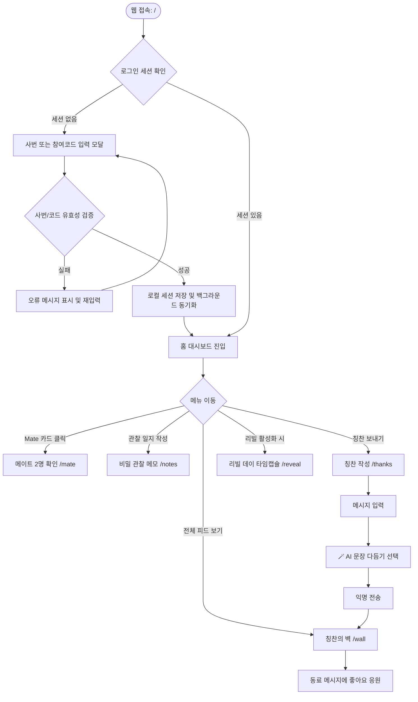
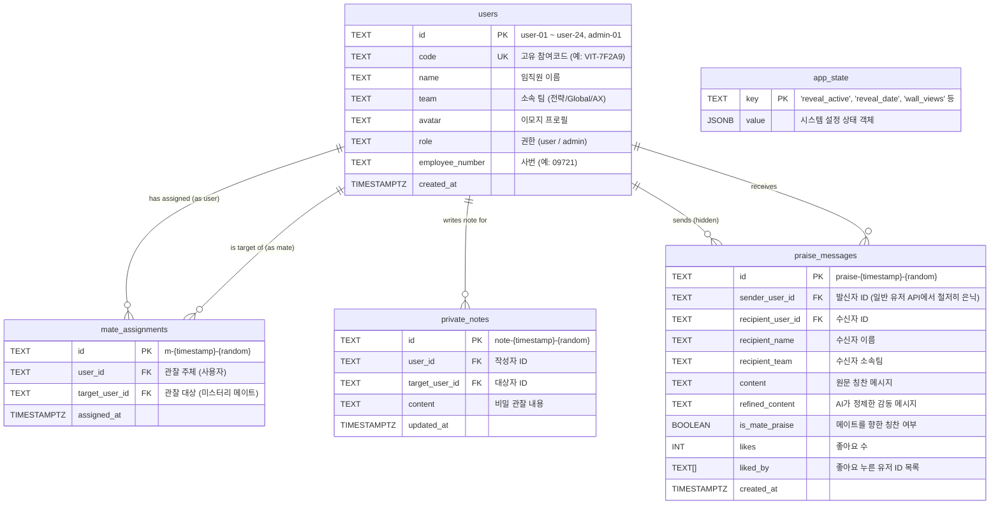
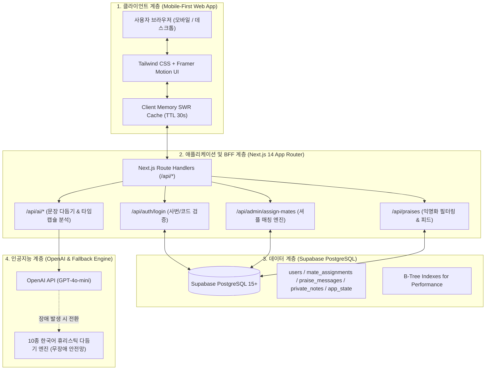

# 💊 HT사업본부 AI Vitamin Program 서비스 전체 기술 및 운영 문서

> **Hi-Tech 사업본부 동료 칭찬 & 미스터리 메이트(Mystery Mate) 사내 조직문화 플랫폼**  
> 기획 배경부터 시스템 아키텍처, 기술 스택, DB 설계, 핵심 알고리즘, 테스트 및 무중단 운영 가이드까지의 종합 기술 명세서입니다.

---

## 📋 목차 (Table of Contents)

1. [서비스 기획 (Service Planning)](#1-서비스-기획-service-planning)
   - 1.1 기획 배경 및 문제 정의
   - 1.2 서비스 목표 및 비전
   - 1.3 타겟 사용자 및 서비스 규모
   - 1.4 핵심 가치 제안 (Value Proposition)
2. [서비스 설계 (Service Design)](#2-서비스-설계-service-design)
   - 2.1 정보 구조 (Information Architecture, IA)
   - 2.2 사용자 경험(UX) 및 플로우
   - 2.3 데이터 모델 및 데이터베이스 설계 (ERD)
   - 2.4 보안 및 익명성 보장 설계
3. [시스템 아키텍처 (System Architecture)](#3-시스템-아키텍처-system-architecture)
   - 3.1 전체 시스템 구조도
   - 3.2 클라이언트-서버 데이터 통신 및 캐싱 전략
   - 3.3 AI 파이프라인 및 결함 감내(Fault-Tolerance) 구조
4. [기술 스택 및 도구 매트릭스 (Tech Stack & Tools)](#4-기술-스택-및-도구-매트릭스-tech-stack--tools)
   - 4.1 Frontend & UI/UX
   - 4.2 Backend & API
   - 4.3 Database & BaaS (Supabase)
   - 4.4 Generative AI & Natural Language Processing
   - 4.5 배포, 인프라 및 운영 도구
5. [핵심 기능 구현 상세 (Core Features)](#5-핵심-기능-구현-상세-core-features)
   - 5.1 사번/참여코드 기반 무암호 간편 인증
   - 5.2 크로스팀(Cross-Team) 우선 셔플 배정 알고리즘
   - 5.3 나만의 비밀 관찰 메모장 (Private Notes)
   - 5.4 AI 문장 다듬기 및 칭찬 메시지 전송 (Anti-Duplication)
   - 5.5 칭찬의 벽 (Vitamin Wall) & 좋아요 인터랙션
   - 5.6 리빌 데이 (Reveal Day) & AI 비타민 타임캡슐
   - 5.7 관리자 센터 (Admin Dashboard)
6. [품질 관리 및 검증 (Quality Assurance & Testing)](#6-품질-관리-및-검증-quality-assurance--testing)
   - 6.1 정적 타이핑 및 빌드 무결성
   - 6.2 운영 중 무중단 데이터 마이그레이션 검증
   - 6.3 외부 API 실패 시나리오 방어 검증
7. [설치 및 운영 가이드 (Installation & Operations)](#7-설치-및-운영-가이드-installation--operations)
   - 7.1 환경 변수 구성 (`.env.local`)
   - 7.2 데이터베이스 초기화 및 시딩
   - 7.3 일일 점검 및 운영 스케줄링
8. [프로젝트 디렉토리 구조 (Directory Structure)](#8-프로젝트-디렉토리-구조-directory-structure)

---

## 1. 서비스 기획 (Service Planning)

### 1.1 기획 배경 및 문제 정의
* **팀 간 소통 사일로(Silo) 현상**: 대규모 본부 조직(전략사업개발팀, Global사업개발팀, AX 사업개발팀 등) 특성상 업무 접점이 적은 타 팀 구성원 간의 심리적 거리감이 발생하기 쉽습니다.
* **표현의 어색함과 칭찬 피로도**: 동료에게 고마움을 느끼더라도 직접 대면하여 표현하기 어색하거나, 상투적인 감사 인사에 그치는 경우가 많습니다.
* **오프라인 마니또 프로그램의 운영 한계**: 종이 쪽지 뽑기나 오프라인 방식의 마니또는 분실, 비밀 누설, 운영자의 수작업 매칭 관리 등 지속적인 참여를 유도하기 어려운 단점이 있습니다.

### 1.2 서비스 목표 및 비전
* **부담 없는 자발적 칭찬 문화 조성**: 익명 기반의 가벼운 관찰과 칭찬 메시지 전달을 통해 일상 속에서 긍정 에너지를 충전합니다.
* **타 팀 간의 자연스러운 유대감 형성**: 다른 팀 동료를 1인당 2명씩 '비밀 마니또(Mystery Mate)'로 배정하여 평소 관심 갖지 못했던 동료의 강점을 발견하도록 유도합니다.
* **AI 기반 인텔리전스 결합**: AI 코치가 작성 중인 칭찬 문장을 더욱 품격 있고 따뜻하게 다듬어주며, 2개월 여정이 끝나는 날 동료들이 보내준 응원을 종합 분석하여 감동적인 개인별 맞춤 타임캡슐을 선사합니다.

### 1.3 타겟 사용자 및 서비스 규모
* **대상 조직**: Hi-Tech 사업본부 (총 24명의 임직원 + 전담 관리자 1명)
  - 전략사업개발팀 (11명)
  - Global사업개발팀 (5명)
  - AX 사업개발팀 (7명)
  - 본부 공통 (1명)
* **운영 기간**: 약 2개월(8주) 간의 관찰 및 칭찬 누적 후 'Reveal Day'를 통한 최종 공개

### 1.4 핵심 가치 제안 (Value Proposition)
1. **Zero-Barrier Access**: 아이디/비밀번호 가입 없이 사번(5자리) 또는 참여코드 입력만으로 1초 만에 개인화된 세션 시작
2. **Absolute Psychological Safety**: 칭찬 발신자(Sender) 식별자는 서버 단에서 엄격히 마스킹되어 완전한 익명성 보장
3. **AI-Assisted Empathy**: 서투른 문장도 정성스럽고 감동적인 문장으로 변환해주는 AI 문장 다듬기 기능
4. **Permanent Digital Asset**: 프로그램 종료 시 본인이 받은 모든 칭찬과 AI 감사 편지를 고해상도 이미지(PNG) 또는 PDF 인증서로 영구 소장

---

## 2. 서비스 설계 (Service Design)

### 2.1 정보 구조 (Information Architecture, IA)

```
[ AI Vitamin Platform ]
 │
 ├── 1. 홈 대시보드 (Home: /)
 │    ├── 오늘의 비타민 한 줄 (AI 데일리 추천 제안)
 │    ├── 나의 미스터리 메이트 바로가기 카드
 │    ├── 실시간 본부 칭찬 현황 & 통계 위젯
 │    └── 접속 인증 모달 (사번/코드 입력)
 │
 ├── 2. 미스터리 메이트 (Mate: /mate)
 │    ├── 배정된 메이트 2명 프로필 카드 (타 팀 우선 배정)
 │    ├── 메이트 비밀 관찰 메모 바로가기
 │    └── 메이트 전용 칭찬 작성 숏컷
 │
 ├── 3. 비밀 관찰 일지 (Notes: /notes)
 │    ├── 메이트별 관찰 일지 작성 및 실시간 저장
 │    └── 나만 볼 수 있는 안전한 개인화 메모 저장소
 │
 ├── 4. 칭찬하기 (Thanks: /thanks)
 │    ├── 본부 전체 동료 검색 및 수신자 선택
 │    ├── 칭찬 문장 작성 에디터
 │    ├── 🪄 AI 문장 다듬기 (중복 방지 & 다양성 엔진)
 │    ├── 에디터 초기화(X) 및 결과 복사(Copy) 도구
 │    └── 비밀 전송 (칭찬의 벽에 즉시 익명 게시)
 │
 ├── 5. 칭찬의 벽 (Wall: /wall)
 │    ├── 본부 전체에 공유된 익명 칭찬 메시지 실시간 피드
 │    ├── 메이트 칭찬 배지 식별자 표시
 │    └── 응원과 공감의 좋아요(Like) 인터랙션
 │
 ├── 6. 리빌 데이 (Reveal Day: /reveal)
 │    ├── 나를 관찰했던 미스터리 메이트 정체 공개
 │    ├── 🎁 AI 비타민 타임캡슐 (맞춤 키워드 5종 + 동료상 분석 + AI 편지)
 │    └── 소장용 카드 이미지(PNG) & PDF 다운로드
 │
 └── 7. 관리자 센터 (Admin: /admin)
      ├── 본부 칭찬 활동 지표 모니터링 (주간/누적/조회수)
      ├── 크로스팀 셔플 배정 원클릭 트리거
      ├── 리빌 데이(D-Day) 공개 토글 및 타겟 일자 제어
      ├── AI 데일리 칭찬 제안 문구 관리 (CRUD)
      └── 임직원 정보/사번/코드 매핑 및 부적절 메시지 관리
```

### 2.2 사용자 경험(UX) 및 플로우



### 2.3 데이터 모델 및 데이터베이스 설계 (ERD)

Supabase PostgreSQL 기반으로 5개의 정규화된 테이블을 운영하며, 고속 조회를 위한 최적화 인덱스를 적용했습니다.



### 2.4 보안 및 익명성 보장 설계
1. **발신자 정보 원천 차단 (Data Masking at BFF Layer)**:
   - `app/api/praises/route.ts`의 `GET` 요청 시, 관리자 세션 파라미터(`?admin=true`)가 없을 경우 `senderUserId` 필드를 `undefined`로 강제 삭제하여 직렬화합니다.
   - 브라우저 개발자 도구의 Network 탭을 분석하더라도 발신자가 누구인지 역추적할 수 없습니다.
2. **Row Level Security (RLS)**:
   - Supabase PostgreSQL 레벨에서 RLS를 활성화하고, 서비스 전용 서버 클라이언트(BFF)를 통해 인가된 작업만 수행합니다.
3. **무암호 사번/코드 인증 (Passwordless Code Auth)**:
   - 사내 내부망 및 한정된 대상(24인)을 위한 간편 접근성을 유지하면서도, 오타나 앞자리 0 누락(예: `9721` vs `09721`)을 자동 패딩 처리하여 사용자 친화적인 보안을 구현했습니다.

---

## 3. 시스템 아키텍처 (System Architecture)

### 3.1 전체 시스템 구조도



### 3.2 클라이언트-서버 데이터 통신 및 캐싱 전략
* **Stale-While-Revalidate (SWR) 인메모리 캐시**:
  - `lib/db.ts`에 30초 유효 시간(TTL)을 가진 전역 `memoryCache`를 두어 페이지 간 이동 시 불필요한 네트워크 중복 호출을 제거했습니다.
  - 칭찬 작성, 메모 저장 등 CUD(생성/수정/삭제) 발생 시 `invalidateCache()`를 통해 해당 도메인의 캐시를 즉시 파기하고 최신 데이터를 갱신합니다.
* **비동기 백그라운드 세션 싱크 (Non-blocking Session Sync)**:
  - 사용자가 앱에 재방문할 때 `localStorage`에 저장된 로컬 세션을 즉시 렌더링한 후, 백그라운드에서 `/api/auth/login`을 호출하여 사용자 이름, 팀명 등 변경 사항이 있을 경우 무중단으로 반영합니다.

### 3.3 AI 파이프라인 및 결함 감내(Fault-Tolerance) 구조
* **이중 안전망 구조**:
  - 1차: OpenAI `gpt-4o-mini` 모델을 활용하여 사용자의 문맥에 최적화된 문장 다듬기 및 타임캡슐 요약 수행
  - 2차: OpenAI API Key 미설정, 네트워크 지연, 레이트 리밋 발생 시 즉각적으로 내장된 고품질 휴리스틱 엔진(10가지 변형 패턴 및 다양성 시드 주입기)으로 페일오버(Failover)되어 서비스 중단이 전혀 발생하지 않습니다.

---

## 4. 기술 스택 및 도구 매트릭스 (Tech Stack & Tools)

| 영역 (Category) | 기술 / 도구명 (Tech / Tool) | 버전 (Version) | 도입 사유 및 역할 |
| :--- | :--- | :--- | :--- |
| **Frontend Framework** | **Next.js** | `14.2.15` | App Router 기반 SSR/CSR 하이브리드 아키텍처, Zero-config 라우팅 및 BFF API Route 통합 제공 |
| **UI Library** | **React** | `18.3.1` | 컴포넌트 기반 선언형 UI 구성, React Hook 기반 상태 제어 |
| **Language** | **TypeScript** | `5.6.3` | 정적 타입 시스템을 통한 컴파일 단계 버그 차단 및 데이터 모델 무결성 유지 |
| **Styling** | **Tailwind CSS** | `3.4.14` | 유틸리티 퍼스트 CSS를 통한 반응형 모바일 최적화 레이아웃 및 디자인 시스템 일관성 확보 |
| **Motion & Animation** | **Framer Motion** | `11.11.9` | 카드 전환, 팝업 등장, 터치 반응형 마이크로 인터랙션 구현 |
| **Visual Effects** | **canvas-confetti** | `1.9.3` | 리빌 데이 및 칭찬 전송 성공 시 축하 꽃가루 파티클 효과 제공 |
| **Export Engine** | **html2canvas** & **jspdf** | `^1.4.1` / `^4.2.1` | AI 타임캡슐 감사 편지를 사용자의 디바이스에서 고해상도 PNG 이미지 및 PDF 문서로 클라이언트 렌더링 및 다운로드 |
| **Icons** | **Lucide React** | `^0.453.0` | 가볍고 일관성 있는 SVG 아이콘 시스템 |
| **Backend / API** | **Next.js Route Handlers** | `14.x` | 별도 백엔드 서버 없이 Serverless Route Handler로 보안 필터링 및 비즈니스 로직 처리 |
| **BaaS / Database** | **Supabase** (PostgreSQL) | `^2.45.6` | 관리형 클라우드 PostgreSQL 15, 실시간 커넥션 풀링, RLS 보안 정책, JSONB 지원 |
| **Generative AI** | **OpenAI API** (`gpt-4o-mini`) | `^4.68.0` | 고속 응답과 경제적인 비용으로 문장 다듬기, 감성 분석, 타임캡슐 키워드 추출 수행 |
| **Package Manager** | **npm** | `10.x` | 종속성 패키지 관리 및 스크립트 실행 |
| **VCS / CI/CD** | **Git & GitHub** | `main` | 소스 코드 버전 관리 및 무중단 배포 연동 |

---

## 5. 핵심 기능 구현 상세 (Core Features)

### 5.1 사번/참여코드 기반 무암호 간편 인증
* **구현 위치**: `components/CodeLoginModal.tsx`, `app/api/auth/login/route.ts`
* **동작 원리**:
  1. 사용자가 부여받은 참여코드(예: `VIT-7F2A9`) 또는 사번(예: `01217` 또는 `1217`)을 입력합니다.
  2. 서버는 5자리 자릿수 보정(`padStart(5, '0')`) 및 대문자 변환 후 인메모리 시드 및 Supabase `users` 테이블에서 일치하는 사용자를 탐색합니다.
  3. 로그인 성공 시 사용자 아바타와 확인 카드가 나타나며, 확인 버튼 클릭 시 로컬 세션이 초기화됩니다.

### 5.2 크로스팀(Cross-Team) 우선 셔플 배정 알고리즘
* **구현 위치**: `app/api/admin/assign-mates/route.ts`
* **알고리즘 상세**:
  1. 관리자(`role === 'admin'`)를 제외한 모든 본부 임직원 리스트를 추출합니다.
  2. 기존 `mate_assignments` 테이블의 레코드를 안전하게 초기화합니다.
  3. 각 사용자($U_i$)에 대해 다음 기준에 따라 후보군을 필터링합니다:
     - **조건 1**: 자기 자신 제외 ($U_k \neq U_i$)
     - **조건 2**: 같은 팀 동료 제외 ($Team_k \neq Team_i$)
  4. 타 팀 동료 수가 2명 미만일 경우에 한해 동일 팀 동료를 후보군에 포함합니다.
  5. 후보군 배열을 무작위 셔플한 후 상위 2명을 선택하여 `mate_assignments`에 일괄(`bulk insert`) 저장합니다.

```typescript
// 크로스팀 우선 셔플 알고리즘 핵심 로직 발췌
users.forEach((user) => {
  let candidates = users.filter(u => u.id !== user.id && u.team !== user.team);
  if (candidates.length < 2) {
    candidates = users.filter(u => u.id !== user.id);
  }
  const shuffled = [...candidates].sort(() => Math.random() - 0.5);
  const selected = shuffled.slice(0, 2);
  selected.forEach(target => {
    newAssignments.push({
      id: `m-${Date.now()}-${Math.random().toString(36).substr(2, 6)}`,
      user_id: user.id,
      target_user_id: target.id,
      assigned_at: now
    });
  });
});
```

### 5.3 나만의 비밀 관찰 메모장 (Private Notes)
* **구현 위치**: `app/notes/page.tsx`, `app/api/notes/route.ts`
* **동작 원리**:
  - 배정된 미스터리 메이트 2명에 대해 평소 업무 협업이나 회의 중 발견한 칭찬할 점을 언제든지 기록해둘 수 있는 비밀 메모장입니다.
  - 작성자 본인(`userId`)만 조회 및 수정할 수 있으며, 타인이나 메이트에게는 공개되지 않습니다.

### 5.4 AI 문장 다듬기 및 칭찬 메시지 전송 (Anti-Duplication)
* **구현 위치**: `app/thanks/page.tsx`, `lib/aiService.ts`, `app/api/praises/route.ts`
* **동작 원리**:
  - 작성자가 거칠게 적은 메모나 짧은 문장(예: *"오늘 발표 자료 만들어줘서 땡큐"*)을 입력하고 `AI 문장 다듬기` 버튼을 누르면 AI가 따뜻하고 품격 있는 문장으로 리파인(Refine)합니다.
  - **상투어 중복 방지 (Anti-Duplication)**:
    - 프롬프트 레벨에서 *"항상 묵묵히..."* 같은 고정 상투어 사용을 엄격히 금지하고, 무작위 다양성 시드(`diversity seed`)를 주입합니다.
    - Fallback 엔진 동작 시에도 10가지 이상의 다채로운 감성 증폭기 중 무작위 함수를 선택하여 매번 신선한 문장을 산출합니다.
  - **사용자 편의 인터랙션**:
    - 입력창 전체 초기화 버튼(`X`)
    - 생성된 AI 다듬은 문장 원클릭 클립보드 복사 버튼(`Copy`)
    - 전송 시 해당 수신자가 나의 메이트인지 서버가 판별하여 `is_mate_praise` 플래그 자동 부여

### 5.5 칭찬의 벽 (Vitamin Wall) & 좋아요 인터랙션
* **구현 위치**: `app/wall/page.tsx`, `app/api/praises/like/route.ts`
* **동작 원리**:
  - 본부 전체에 도착한 칭찬 메시지들이 실시간 피드 형태로 표시됩니다.
  - 발신자 이름은 완전 차단되어 익명성을 보장하며, 메이트 칭찬일 경우 `Mystery Mate 칭찬 💊` 배지가 부여됩니다.
  - 구성원 누구나 마음에 드는 칭찬 글에 하트(좋아요)를 눌러 응원할 수 있으며, 중복 클릭 시 토글(취소)됩니다.

### 5.6 리빌 데이 (Reveal Day) & AI 비타민 타임캡슐
* **구현 위치**: `app/reveal/page.tsx`, `lib/aiService.ts`
* **동작 원리**:
  - 관리자가 리빌 데이를 활성화하면 열리는 최종 피날레 화면입니다.
  - 나를 관찰했던 2명의 미스터리 메이트가 누구였는지 공개됩니다.
  - **AI 타임캡슐 분석 엔진**:
    1. 지난 2개월간 내가 받은 모든 칭찬 메시지를 수집합니다.
    2. AI가 이를 자연어 분석하여 **핵심 키워드 5가지**(예: `협업`, `배려`, `책임감`, `전문성`, `긍정에너지`)를 도출합니다.
    3. *"동료들은 OOO님을 항상 묵묵히 돕고 밝은 에너지를 주는 든든한 조력자로 기억했습니다"* 형태의 1~2문장 맞춤 페르소나 분석을 생성합니다.
    4. 감동적인 헌정 감사 편지를 작성합니다.
  - **디지털 소장 기능**:
    - `html2canvas`와 `jspdf`를 통해 화면의 타임캡슐 인증서를 고해상도 이미지(`PNG`) 또는 공식 인증서(`PDF`)로 즉시 내보내기 및 다운로드할 수 있습니다.

### 5.7 관리자 센터 (Admin Dashboard)
* **구현 위치**: `app/admin/page.tsx`
* **동작 원리**:
  - 환경변수(`ADMIN_CODE` 또는 `ADMIN_CODE_HASH`)로 설정된 관리자 인증 코드로 로그인 시 안전한 HttpOnly 세션 쿠키가 발급되며 진입 가능합니다.
  - **활동 통계**: 누적 칭찬 수, 주간 칭찬 수, 등록 메모 수, 칭찬의 벽 조회수, D-Day 카운트다운을 한눈에 파악합니다.
  - **셔플 배정 실행**: 모달 확인을 거쳐 전체 임직원 대상 크로스팀 셔플을 1초 만에 재배정합니다.
  - **리빌 데이 On/Off 제어**: 클릭 한 번으로 전사 리빌 데이 화면을 즉시 개방하거나 비공개로 전환합니다.
  - **칭찬 제안(Suggestions) 관리**: 홈 화면에 노출되는 일일 칭찬 팁 문구를 실시간 추가/삭제합니다.
  - **사서함 관리**: 부적절한 테스트 메시지나 비방 글을 즉시 삭제할 수 있습니다.

---

## 6. 품질 관리 및 검증 (Quality Assurance & Testing)

### 6.1 정적 타이핑 및 빌드 무결성
* 모든 컴포넌트와 API 핸들러는 TypeScript Strict Mode 하에서 컴파일됩니다.
* 배포 전 `npm run build`를 통해 모든 16개 정적/동적 라우트의 컴파일 및 타입 무결성을 검증합니다:
  ```bash
  $ npm run build
  ✓ Compiled successfully
  ✓ Linting and checking validity of types
  ✓ Collecting page data
  ✓ Generating static pages (16/16)
  ✓ Finalizing page optimization
  ```

### 6.2 운영 중 무중단 데이터 마이그레이션 검증
* **실시간 운영 서비스 무중단 원칙**:
  - 서비스가 라이브 운영되는 상태에서 임직원 이름 수정(예: `조성현` ➔ `조상현`), 사번 매핑 컬럼 추가 및 신규 사용자 반영 등의 작업을 DB 락(Lock)이나 서비스 다운타임 없이 수행했습니다.
  - Node.js 스크립트 및 Supabase 클라이언트를 통해 `users` 및 `praise_messages` 테이블의 무결성을 실시간으로 패치하고 즉시 검증했습니다.

### 6.3 외부 API 실패 시나리오 방어 검증
* OpenAI API 키가 설정되지 않았거나 네트워크 통신 장애(Timeout, DNS 오류 등)가 발생하더라도 프론트엔드가 크래시되지 않고 내장 Fallback 데이터로 부드럽게 전환(Graceful Degradation)되는 것을 확인했습니다.
* Supabase 연결 실패 시 사용자 화면에 명확한 안내 모달(`SupabaseConfigError.tsx`)을 표시하여 시스템 오류로 인한 혼란을 방지했습니다.

---

## 7. 설치 및 운영 가이드 (Installation & Operations)

### 7.1 환경 변수 구성 (`.env.local`)
루트 디렉토리에 `.env.local` 파일을 생성하고 아래 키를 구성합니다:

```env
# Supabase Production Configuration
NEXT_PUBLIC_SUPABASE_URL=https://<your-project-id>.supabase.co
SUPABASE_URL=https://<your-project-id>.supabase.co

NEXT_PUBLIC_SUPABASE_PUBLISHABLE_KEY=sb_publishable_<your-key>
SUPABASE_PUBLISHABLE_KEY=sb_publishable_<your-key>
SUPABASE_SECRET_KEY=your_secret_key_here

# Session & Admin Security
SESSION_SECRET=your_32_character_long_session_secret_key
ADMIN_CODE=your_custom_admin_access_code

# OpenAI API Configuration (Optional: 고품질 스마트 Fallback 자동 탑재)
OPENAI_API_KEY=sk-proj-<your-openai-api-key>
```

### 7.2 데이터베이스 초기화 및 시딩
1. Supabase SQL 에디터에서 `supabase_schema.sql` 스크립트를 실행하여 5개 테이블 및 인덱스를 생성합니다.
2. 애플리케이션 실행 후 환경변수로 설정한 관리자 코드로 로그인합니다.
3. `/admin` 페이지에서 **"초기 데이터 시딩"** 및 **"Mystery Mate 2명 셔플 배정"** 버튼을 순차적으로 실행하여 본부 임직원 24명을 등록하고 메이트를 배정합니다.

### 7.3 일일 점검 및 운영 스케줄링
* **서비스 점검 주기**: 매일 오전 8시 헬스체크 권장
* **점검 체크리스트**:
  1. `/api/auth/login` 응답 정상 여부 (HTTP 200)
  2. `/api/praises` 칭찬 피드 스트리밍 정상 여부
  3. 관리자 대시보드 내 활동 지표 증가 추이 확인
  4. 칭찬 피드 내 부적절한 어휘 필터링 및 관리자 삭제 기능 점검

---

## 8. 프로젝트 디렉토리 구조 (Directory Structure)

```
AI Vitamin/
├── app/                              # Next.js 14 App Router 디렉토리
│   ├── admin/page.tsx                # 관리자 대시보드 화면
│   ├── api/                          # 백엔드 Route Handlers (BFF)
│   │   ├── admin/assign-mates/       # 셔플 배정 API
│   │   ├── admin/seed/               # 데이터베이스 시딩 API
│   │   ├── ai/capsule/               # AI 타임캡슐 분석 API
│   │   ├── ai/refine/                # AI 문장 다듬기 API
│   │   ├── ai/suggest/               # 데일리 칭찬 제안 API
│   │   ├── auth/login/               # 사번/코드 기반 인증 API
│   │   ├── mates/                    # 나의 메이트 조회 API
│   │   ├── notes/                    # 비밀 관찰 메모 API
│   │   ├── praises/                  # 칭찬 메시지 CRUD 및 좋아요 API
│   │   ├── reveal/                   # 리빌 데이 상태 제어 API
│   │   ├── stats/                    # 본부 활동 통계 API
│   │   └── users/                    # 임직원 목록 조회 API
│   ├── mate/page.tsx                 # 나의 미스터리 메이트 카드 화면
│   ├── notes/page.tsx                # 비밀 관찰 일지 화면
│   ├── reveal/page.tsx               # 리빌 데이 & AI 타임캡슐 화면
│   ├── thanks/page.tsx               # 칭찬 작성 및 AI 다듬기 화면
│   ├── wall/page.tsx                 # 칭찬의 벽 전체 피드 화면
│   ├── globals.css                   # Tailwind CSS 전역 스타일
│   ├── layout.tsx                    # 루트 레이아웃 및 폰트 설정
│   └── page.tsx                      # 메인 홈 대시보드 화면
├── components/                       # 재사용 공통 컴포넌트
│   ├── CodeLoginModal.tsx            # 사번/참여코드 간편 로그인 모달
│   ├── MobileLayout.tsx              # 모바일 퍼스트 프레임 & 하단 탭바
│   ├── Splash.tsx                    # 인트로 스플래시 애니메이션
│   └── SupabaseConfigError.tsx       # 인프라 미연결 안내 컴포넌트
├── lib/                              # 비즈니스 로직 및 유틸리티
│   ├── aiService.ts                  # OpenAI 및 스마트 Fallback 다듬기 엔진
│   ├── db.ts                         # 클라이언트 SWR 캐시 및 API 통신 모듈
│   ├── seedData.ts                   # 24인 임직원/사번/코드 초기 마스터 데이터
│   ├── supabase.ts                   # Supabase 서버/클라이언트 팩토리
│   └── types.ts                      # 전역 TypeScript 인터페이스 정의
├── public/                           # 정적 에셋 (아이콘 및 이미지)
├── supabase_schema.sql               # PostgreSQL 프로덕션 DDL 스키마
├── package.json                      # 종속성 명세 및 빌드 스크립트
├── tailwind.config.ts                # Tailwind CSS 설정
└── tsconfig.json                     # TypeScript 컴파일러 설정
```

---
*문서 최종 개정일: 2026년 10월 11일*  
*작성 및 관리: Hi-Tech 사업본부 조직문화 TF & AI Vitamin 운영팀*
